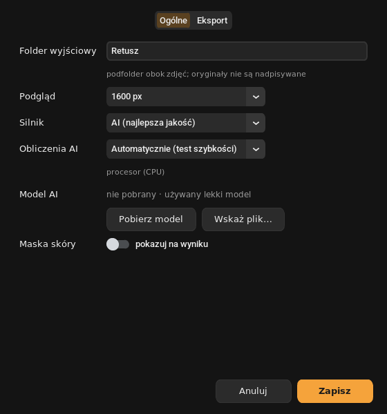
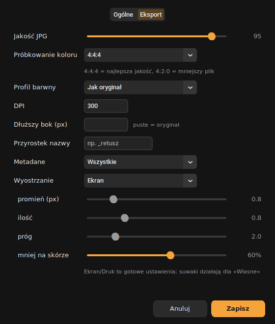

# Retusz 0.9.0

Aplikacja na Windows: profesjonalny edytor portretowy z **minimalistycznym układem studyjnym Adobe Lightroom Classic (1 kolumna spokojnych, neutralnych suwaków, wyśrodkowany portret ze zwijanym paskiem serii `F6`, interaktywny Histogram ze strefami tonalnymi i kołowym Wektorskopem Skóry OKLCh 52°)**, modułami **Biblioteka (G)** i **Edycja (D)**, akceleracją **Intel iGPU OpenCV OpenCL (`cv2.ocl` / `UMat`) + DirectML**, **`★ Auto Ton AI v2` (kąt fototypu $\text{ITA}^\circ$ Chardon 1991)** i **`Auto WB v2` (Shades-of-Gray $p=6$)**, nieniszczącym pędzlem **`✦ Usuń / Popraw (Q)`** z transferem tekstury porów, **8-kanałowym Mikserem OKLCh HSL i 3-drożnym Color Gradingiem OKLab**, kalibracją **ColorChecker Classic (24 pola + raport ΔE₀₀)**, obsługą **wielu wzorców kolorystycznych w jednej serii**, ratowaniem **Światła mieszanego (LED / Błysk)**, dwuosiowym **Światłem 3D**, biofizyczną optyką skóry oraz oknem **Eksportuj jako… (TIFF/PNG 16-bit, WebP, JPG 4:4:4, ProPhoto RGB, Display P3, Adobe RGB, sRGB)**. Autor: Jack4B.

## Kontrola jakości

`tools/quality_gate.py` – bramka uruchamiana przed każdym wydaniem: porównuje wynik z wzorcem (LAB średnia/odchylenie, chroma i odcień skóry, kolorowość Hasler–Süsstrunk ≤ wzorzec +5%, przepalenia), sprawdza szwy/halo od Dodge&Burn i Plastyki 3D (próg szwu < 0,5 ΔL), identyczność (zdjęcie = wzorzec) oraz zgodność podglądu z eksportem (ΔE < 1). Tryb `--colorchecker` sprawdza detekcję i kalibrację 24 pól ColorChecker (średnie ΔE₀₀ < 1,2, skóra < 1,0, szarości < 0,8).

### 0.9.0
- **Przebudowa UI i ergonomii pracy (UX) według makiety studyjnej Lightroom Classic** (`retusz/gui/app.py`, `theme.py`, `histview.py`, `dialogs.py`):
  - **Minimalistyczny pasek górny**: złote menu **`Otwórz ▾`**, lista **`Presety ▾`**, wyśrodkowany przełącznik modułów **`Biblioteka (G) | Edycja (D) | Porównaj | Grading z AI`**, ściąga skrótów **`?`** oraz przyciski **`Zapisz`** i **`Eksportuj…`**;
  - **Spokojne, neutralne suwaki (`T.lr_slider`) i wyśrodkowane płótno portretu**: szare prowadnice ze srebrnym kołowym uchwytem eliminują wizualny hałas pomarańczowych pasków na wyzerowanych suwakach dwubiegunowych; lewy pasek miniatur serii jest zwijany przyciskiem **`▣`** (`F6`);
  - **5 przejrzystych zakładek Develop**: `Podstawowe`, `Portret 3D`, `Kolor HSL`, `Detal`, `Wzorzec` z przyciskami szybkiego podglądu bez aktywnej zakładki (**`👁`**) oraz zerowania samej zakładki (**`↺`**);
  - **4-stopniowa ergonomia sterowania i interaktywny Histogram**: kółko myszy nad suwakiem (`±2`, `Shift`: `±10`), płynny *scrubbing* po nazwie suwaka, kliknięcie wartości liczbowej do wpisania z klawiatury, dwuklik zerujący oraz **przeciąganie stref tonalnych bezpośrednio na Histogramie** (`Czernie | Cienie | Ekspozycja | Światła | Biele`);
  - **Selektywne kopiowanie ustawień (`Kopiuj…`, `Ctrl+Shift+C`)** z wyborem grup parametrów (kadr domyślnie odznaczony) oraz **flagi selekcji Lightroom (`Wybrane ⚑` klawisz `P`, `Odrzucone ✕` klawisz `X`, `U`)**.
- **Akceleracja zintegrowanych kart Intel iGPU (OpenCV OpenCL `cv2.ocl` / `UMat`) oraz optymalizacja DirectML** (`retusz/engine/device.py`, `settings.py`, `detail.py`, `cli.py`):
  - nowy tryb **`Procesor + OpenCV OpenCL (Intel iGPU)`** (`--device ocl`), przyspieszający filtry rozmycia Gaussa i skalowanie na dużych kadrach (`≥ 0,4 Mpx`) na układach zintegrowanych Intel UHD / Iris Xe / Arc przez `cv2.UMat` z automatycznym fallbackiem CPU;
  - konfiguracja sesji ONNX Runtime DirectML pod współdzieloną pamięć iGPU (`enable_mem_pattern=False`, `ORT_SEQUENTIAL`, dwukrotna rozgrzewka shaderów DX12 przed pomiarem czasu).
- **`★ Auto Ton AI v2` z kątem fototypu karnacji $\text{ITA}^\circ$ (Chardon et al., 1991) oraz `Auto WB v2`** (`retusz/engine/tone.py`, `wb.py`):
  - jawne rozdzielenie skali CIE $L^*$ (`0..100`) i OKLab $L$ (`0..1`) oraz dobór docelowej jasności skóry na podstawie kąta typologii indywidualnej $\text{ITA}^\circ = \arctan((L^* - 50)/b^*)$, dzięki czemu ciemne karnacje i portrety *low-key* nie są sztucznie rozjaśniane;
  - jednoklikowy **`Auto WB`** oparty na algorytmie stałości barw *Shades-of-Gray* (norma Minkowskiego $p=6$, Finlayson & Trezzi 2004) z wykluczeniem wykrytych twarzy i pasma skóry (nie ochładza naturalnie ciepłej karnacji).
- **Nieniszczący Pędzel `✦ Usuń / Popraw (Q)` z zachowaniem porów skóry** (`retusz/engine/skin_physics.py:apply_heal_strokes`):
  - dwupasmowy retusz lokalny (inpainting Telea na paśmie niskich częstotliwości + transfer łatki wysokoczęstotliwościowej struktury porów i ziarna ze zdrowego otoczenia), zapisywany nieniszcząco w plikach bocznych `*.retusz.json` (`heal_strokes`).
- **Pełny 8-kanałowy Mikser OKLCh HSL i 3-drożny Color Grading OKLab** (`retusz/engine/tone.py:apply_color_grading_oklab`):
  - indywidualna regulacja **Nasycenia**, **Odcienia** i **Jasności** w 8 pasmach barwnych (`Czerwony`, `Pomarańcz`, `Żółty`, `Zielony`, `Turkus`, `Niebieski`, `Fiolet`, `Magenta`) oraz tonowanie **Cieni**, **Półtonów** i **Świateł** z suwakiem **Balans gradingu** i ochroną karnacji.
- **Dwuetapowa weryfikacja anatomiczna twarzy YuNet i obsługa szerokich kadrów grupowych** (`retusz/engine/faces.py`):
  - geometryczna i chromatyczna weryfikacja 5 punktów orientacyjnych (eliminacja fałszywych detekcji na tle/ubraniach) oraz skanowanie w zakładkowych kaflach z deduplikacją IoU dla szerokich zdjęć grupowych.
- **Spójność licencyjna MIT i weryfikacja kryptograficzna SHA-256 modeli ONNX** (`LICENSE`, `THIRD_PARTY_LICENSES.md`, `pyproject.toml`, `Cargo.toml`).

### 0.8.0
- **Autentyczny układ Adobe Lightroom Classic — 1 kolumna szerokich suwaków i redukcja szumu wizualnego** (`retusz/gui/app.py`):
  - **Jedna pionowa kolumna suwaków w stylu Lightroom Classic**: zastąpiono dwukolumnową siatkę wąskich suwaków czytelnym układem `[Etykieta po lewej] ─── [Szeroki suwak] ─── [Wartość po prawej]`;
  - **Subtelny pasek gradientu wyłącznie pod suwakami barwnymi** zamiast powtarzających się podpisów tekstowych pod każdym suwakiem;
  - **Składana szuflada narzędzi lokalnych**: domyślnie zwinięta pod paskiem narzędzi pod histogramem — otwiera się po aktywowaniu pędzla lub kadrowania (`C`) i zamyka przyciskiem `Gotowe ✕`, `Enter`, `Esc` lub po przełączeniu zakładki;
  - **Dolny pasek narzędzi pod zdjęciem (Lightroom Loupe Toolbar `T`)**: tryby widoku (`Wynik | Przed | Po | Podział | Z wzorcem`), `Przed/Po (\)`, ocena gwiazdkowa `0..5★` oraz zoom (`Dopasuj`, `1:1`, `%`).
- **`★ Auto Ton AI` — jednoklikowy balans ekspozycji i rozpiętości tonalnej pod twarz** (`retusz/engine/tone.py:auto_tone_params`).
- **Color Grading OKLab (Split Toning) i Selektywny Mikser HSL OKLCh z izolacją skóry** (`retusz/engine/tone.py:apply_color_grading_oklab`):
  - **`Ciepło cieni` (`shadow_tone`, `-100..+100`)**, **`Blask świateł` (`highlight_tone`, `-100..+100`)**, **`Zieleń (Plener)` (`hsl_green`)** oraz **`Błękit (Niebo/Biel)` (`hsl_blue`)** z ochroną pasma odcienia skóry ($50^\circ$ OKLCh).
- **`Światło mieszane (LED / Błysk)` — ratowanie twarzy oświetlonej dwoma różnymi światłami (pół twarzy białej, pół czerwonej)** (`retusz/engine/skin_physics.py:mixed_light_gain`, `mixed_light_face_mask`):
  - **anatomiczna maska twarzy odporna na skrajne zafarby (`mixed_light_face_mask`)** oraz **dwuźródłowa adaptacja chromatyczna w OKLab/OKLCh (`mixed_light_gain`, Hsu et al., SIGGRAPH 2008)** z zachowaniem wysokoczęstotliwościowej tekstury porów.
- **Ulepszona detekcja wielu twarzy w okularach (`YuNet`)** (`retusz/engine/faces.py`).

### 0.7.0
- **Układ interfejsu w stylu Adobe Lightroom / Capture One Pro (`Prawy Dok Inspektora`)** (`retusz/gui/app.py`):
  - przeniesienie wszystkich suwaków, histogramu, wektorskopu skóry i narzędzi lokalnych z dolnego paska do **Prawego Doku Inspektora** zwiększa pionową wysokość roboczą zdjęcia o ~40%;
  - podpowiedzi kierunkowe (`SLIDER_HINTS`) oraz panel podpowiedzi kontekstowych (`PRO_TIPS`).
- **Dwuosiowe Światło 3D (`Lewo ↔ Prawo` oraz `Dół ↔ Góra`) i Separacja tła 3D (`bg_exposure`)** (`retusz/engine/relight.py`, `retusz/engine/pipeline.py`):
  - pozycjonowanie wirtualnego softboxa 3D na półsferze $(L_x, L_y, L_z)$ względem mapy normalnych powierzchni twarzy;
  - selektywna zmiana ekspozycji tła w świetle liniowym ($\pm 0{,}75\text{ EV}$) na podstawie wygładzonej filtrem prowadzącym maski głębi 3D i maski skóry (ochrona twarzy i miękkie przejście na krawędziach).
- **Wizualna diagnostyka pracy AI (`Maska AI (M)`) oraz import wybranych zdjęć z folderu** (`retusz/engine/histo.py`, `retusz/sidecar.py`, `retusz/gui/library.py`).

### 0.6.0
- **Moduły `Biblioteka (G)` i `Edycja (D)` w stylu Lightroom / Capture One** (`retusz/gui/library.py`, `retusz/gui/app.py`):
  - **Biblioteka (`G`)**: widok siatki miniatur serii (Contact Sheet) z filtrowaniem, oceną gwiazdkową `1–5 ★`, wielokrotnym zaznaczaniem do grupowego przypisywania wzorców lub presetów oraz przejściem do **Edycji (`D`)**;
  - **Wiele wzorców kolorystycznych w jednej serii (`reference_path`, `reference_bank`)** (`retusz/sidecar.py`, `retusz/batch.py`).
- **Zakładka `Detal` oraz parametry klasy Capture One / Lightroom** (`retusz/engine/detail.py`, `retusz/engine/tone.py`):
  - **4 tryby wyostrzania na żywo (`sharpen_mode` + `Ostrość`)**: *Portret (ochrona skóry — morfologiczny Clamped USM ograniczający obwódki)*, *Dekonwolucja RL (obiektyw)*, *Krawędzie (Clamped USM)*, *Miękki blask (Soft Focus)*;
  - **Struktura (`texture`)**, **Odszumianie (`denoise`)**, **Jasność / Półtony (`brightness`)** oraz **Zamglenie (`dehaze`)**.
- **Okno `Eksportuj jako… (Ctrl+Shift+E)` — 6 formatów i 5 przestrzeni barwnych ICC** (`retusz/export.py`, `retusz/colorman.py`, `retusz/gui/dialogs.py`).

### 0.5.0
- **Biofizyczna optyka skóry, dychromatyczny De-Shine SUV, Fast LLF i Wektorskop OKLCh** (`retusz/engine/skin_physics.py`, `retusz/engine/llf.py`, `crates/retusz-core/src/skin_physics.rs`):
  - **Redukcja połysku (`deshine`, 0–100%)**: dychromatyczna separacja połysku w przestrzeni SUV (Mallick et al. 2005; Yang, Wang & Ahuja 2010) usuwa tłuste odblaski z czoła, nosa i policzków, odzyskując barwę podpowierzchniową z zachowaniem pasma wysokich częstotliwości porów;
  - **Separacja chromoforów Melanina / Hemoglobina** w dziedzinie gęstości optycznej $-\log_{10}(I_{\text{lin}})$ (Tsumura et al., SIGGRAPH 2003);
  - **Niedoskonałości (`blemish`, 0–100%)**: dwupasmowy Auto-Heal w kanonicznej skali twarzy (`256 px` — zgodność podglądu i eksportu ΔE < 1);
  - **Oczy i zęby (`eyes_teeth`, 0–100%)**: anatomicznie maskowane z 5 punktów YuNet podbicie mikrokontrastu tęczówki, oczyszczenie białek oczu oraz zmniejszenie żółtego zafarbu zębów;
  - **Szybka Lokalna Piramida Laplace'a (`Fast Local Laplacian Filter`, Aubry et al., ACM TOG 2014)** dla suwaka **Przejrzystość** (wieloskalowy kontrast lokalny ograniczający efekt halo na krawędziach o wysokim kontraście);
  - **Wektorskop Linii Skóry OKLCh (52°)** oraz interaktywny tryb widoku **`Podział`**.

### 0.4.0
- **Jakość studyjna potoku obrazu (RAW / Soft-Knee / Linear Downsizing / Halo-Free USM / 16-bit TIFF)**:
  - **zachowujące barwę łagodzenie świateł RAW (`rawio.shoulder_rgb`)** oraz rozszerzenie obsługi formatów RAW o **`.nef`, `.nrw`, `.cr2`, `.cr3`, `.arw`, `.dng`, `.raf`, `.orf`, `.rw2`, `.pef`**;
  - **ochrona tekstury porów w światłach (`_gain_channel` / `apply_gain_soft_knee`)** w jądrze renderującym (Numba, NumPy, Rust, WGSL): dodatni zysk przestrzenny (Plastyka 3D, Przejrzystość, Pędzel Rozjaśnij) jest płynnie kompresowany wymierną funkcją zapasu do bieli, dzięki czemu jasne czoło i grzbiet nosa nigdy nie tracą faktury porów;
  - **skalowanie wyjściowe w świetle liniowym (`export.resize_long_edge`)**: zachowuje pełną energię fotonów w blikach oczu, biżuterii i drobnych jasnych detalach przy zmniejszaniu zdjęć do internetu;
  - **bezhalowe wyostrzanie wyjściowe (`export.sharpen`)**: ograniczenie sygnału USM lokalną obwiednią morfologiczną 3×3 eliminuje jasne obwódki (overshoot) wokół ciemnych oprawek okularów i rzęs;
  - **eksport 16-bit TIFF (LZW + profil ICC) oraz bezstratny PNG** obok JPG w `Ustawienia → Eksport` i CLI (`--format jpg|tiff16|png`);
  - przycisk **`→ seria`** bezpośrednio na głównym pasku akcji suwaków do błyskawicznego przeniesienia całego wypracowanego looku na całą sesję.

### 0.3.0
- **Kalibracja ColorChecker Classic (24 pola + raport ΔE₀₀)** (`retusz/engine/colorchecker.py`, `crates/retusz-core/src/colorchecker.rs`):
  - **automatyczna detekcja tablicy 6×4** odporna na skalę, położenie i pełny obrót 0–360° (automatyczna orientacja po 6 polach neutralnych `#19 Biały` → `#24 Czarny`);
  - **kalibracja Root-Polynomial Color Correction (Finlayson, Mackiewicz & Hurlbert 2015)** w świetle liniowym z priorytetową wagą dla pól skóry (`#1 Ciemna skóra`, `#2 Jasna skóra`) i skali neutralnej (`#19–#24`), wypalana do tetraedrycznego LUT 33³ z ochroną gamutu OKLab;
  - **tryb „Dopasuj serię do ColorChecker”** w zakładce `▸ Wzorzec (AI)` (przyciski **Z pliku…** oraz **Z kadru**) i w CLI (`python -m retusz cli FOLDER --colorchecker tablica.jpg`);
  - **raport ΔE₀₀ (przed → po)** i wizualna nakładka diagnostyczna 24 pól (lewa połowa pola = cel D65, prawa = kolor po kalibracji);
  - nowa bramka jakości `python tools/quality_gate.py --colorchecker OUTDIR [zdjęcia...]`.
- **Kontrola zafarbów i odcienia skóry w OKLCh** (`skin_cast`, `skin_hue`):
  - **Czysta skóra (0–100%)**: automatyczna redukcja obcych zafarbów na skórze (zielony refleks od liści/trawy, magentowy LED, siny cień) ku naturalnemu pasmu karnacji w przestrzeni biegunowej OKLCh przy 100% zachowaniu jasności $L$ i tekstury porów;
  - **Odcień skóry (−100…+100)**: płynna regulacja kąta odcienia skóry (chłodniejszy/różowy ↔ cieplejszy/złoty) wyłącznie wewnątrz adaptacyjnej maski skóry.
- **Workflow serii (`→seria` i `--preset`)**:
  - przycisk **`→seria`** w sekcji `Presety` oraz flaga CLI `--preset "Nazwa"` nakładają wybrany styl na całą serię z zachowaniem indywidualnego kadru i prostowania każdego zdjęcia.

### 0.2.0
- **Pełnoprawny edytor studyjny (samodzielna praca bez wzorca + dopasowanie do wzorca jako otwierana sekcja dodatkowa)**:
  - aplikacja działa od razu po otwarciu zdjęcia lub folderu (`Engine.fit(..., ref=None)`) — pełna obróbka tonalna OKLab/EV, Bradford CAT, Dodge&Burn v2, Plastyka 3D, kadr, pędzel i eksport JPG/serii nie wymagają wybierania zdjęcia wzorcowego;
  - przełącznik widoku głównego płótna: **Wynik** (pełny ekran na jedno zdjęcie), **Przed | Po** (dwa zsynchronizowane widoki) oraz **Z wzorcem** (3 kolumny, włączane automatycznie po wybraniu wzorca);
  - **Dopasowanie do wzorca (`▸ Wzorzec (AI)`)** wydzielone do osobnej, otwieranej na żądanie zakładki z przyciskami **Wybierz wzorzec…** i **Wyłącz wzorzec** oraz suwakami *Siła kolorów* i *Ochrona skóry*.
- **Biblioteka Presetów (`*.retusz-preset.json`)**:
  - 6 wbudowanych stylów studyjnych: *Portret naturalny*, *Ciepły złoty*, *Filmowy miękki*, *High-Key (jasny)*, *Studyjny kontrast 3D*, *B&W Klasyczny*;
  - przycisk **`+ Zapisz`** zapisuje własne presety użytkownika (zachowując kadr i prostowanie każdego zdjęcia).
- **Silnik i edytor w Rust + `wgpu` (GPU) + `egui` (`crates/retusz-core`, `crates/retusz-gpu`, `crates/retusz-app`)**:
  - natywny workspace Cargo kompilowany do szybkiego pliku wykonywalnego `Retusz-Studio-GPU.exe` (`retusz-rs`) z compute shaderem WGSL (`render_main.wgsl`: LUT 33³ tetraedryczny + zysk D&B/Plastyki 3D/Przejrzystości + winieta + zebra przepaleń) i wielowątkowym CPU `rayon`, współdzielący format `*.retusz.json` i `*.retusz-preset.json`.
- **Instalator Windows (`Retusz-Setup-x64.exe`, Inno Setup 6)**:
  - każde wydanie publikuje w GitHub Releases zarówno instalator **`Retusz-Setup-x64.exe`** (polski kreator, ikony Menu Start / Pulpit, deinstalator), jak i paczkę portable **`Retusz-windows-x64.zip`**.

### 0.1.8
- **Przebudowane okno „Przenieś grading z AI”**:
  - **Widok Obok siebie** (domyślny): dwa zsynchronizowane podglądy **Oryginał (przed) | Wynik (po)** lub **Wersja AI | Wynik (po)** z wspólnym przesuwaniem i przybliżaniem (do 400%);
  - **Prawdziwe 1:1 w pełnej rozdzielczości** przy przybliżeniu (`Dopasuj`, `100%`, `200%`, `Ctrl+0/1/2`, kółko myszy wokół kursora) — po stronie Oryginału i Wyniku widać natywne ziarno i ostrość bez skalowania z podglądu;
  - **Podział**, **Miganie** i szybkie **Przed/Po (`\`)** obsługują porównanie zarówno z **Oryginałem**, jak i z **Wersją AI**;
  - **Natychmiastowe suwaki i pędzel (`PreviewCache`)**: jednorazowy cache siatki BGU i Lab podglądu, dwuklik przywraca 100%, **Cofnij (`Ctrl+Z`)** i `[` / `]` dla pędzla jasności;
  - **Pasek postępu etapów** podczas dopasowania i zapisu oraz przycisk **Zapisz i edytuj** otwierający gotowy eksport w głównym edytorze (oryginał pozostaje nietknięty);
  - **Poprawka krytycznego błędu na prawdziwych zdjęciach z AI** (`align.py:full_to_ai`): przy aktywnym przepływie optycznym (`flow=True`, typowym dla Gemini / Nano Banana) podgląd > 32 767 pikseli nie powoduje już błędu OpenCV `SHRT_MAX`.

### 0.1.7
- **Nowe parametry obróbki i silnik tonalny OKLab** (działają także przy `Siła kolorów = 0%`, w tablicy 3D LUT bez kosztu wydajności; podgląd = eksport ΔE < 1):
  - **Ekspozycja (−2,00…+2,00 EV)** w świetle liniowym z filmowym, zachowującym barwę łagodzeniem świateł (koniec z żółtym przepalaniem skóry);
  - **Kontrast** (monotoniczna krzywa S w OKLab wokół szarości 18%, bez przesycania skóry), **Biele** i **Czernie** (punkty końcowe niezależne od Świateł/Cieni);
  - **Jaskrawość i Nasycenie w OKLab** ze stałym odcieniem przy kompresji gamutu (niebieskie niebo nie skręca już w fiolet);
  - **Przejrzystość (−100…+100)** – bezhalowy kontrast lokalny półtonów na filtrze prowadzonym, chroniący fakturę skóry (ujemna daje miękki, portretowy blask).
- **Najwyższa jakość algorytmów silnika**:
  - **Interpolacja tetraedryczna LUT 3D** (4 narożniki zamiast 8 w jądrze numba): mniejszy błąd barwy i idealnie neutralna oś szarości;
  - **Balans bieli Bradford CAT** (standard CIE/ICC w przestrzeni czopków): naturalniejsza skóra i niebo przy mocnych korektach, dokładna jedno-klikowa pipeta;
  - **Plastyka 3D – segmentacja postaci (GrabCut + 3-kanałowy filtr prowadzony RGB)**: odcina fragmenty tła, które model głębi uznał za bliskie i stykające się z głową lub ramionami;
  - **Czysta maska skóry** (`faces.skin_mask`): kalibracja na rdzeniu policzków/czoła + spójność z rdzeniem twarzy + dociągnięcie filtrem prowadzonym RGB — odrzuca ciemnobrązowe włosy i skóropodobne plamy tła zanim trafią do LUT skóry;
  - **Dodge & Burn v2**: dwustronnie ważony filtr prowadzony i 3-kanałowe dociąganie maski po krawędziach RGB.
- **Przegląd i ulepszenia UX/UI**:
  - przejrzysty, dwuzakładkowy panel suwaków (**Światło i Kolor** / **Wzorzec i Portret**) o stałej wysokości (zero skakania układu);
  - **dwuklik na dowolnym suwaku** (lub etykiecie) przywraca jego wartość domyślną; aktywne wartości są wyróżnione;
  - pełne **Cofnij / Ponów** (`Ctrl+Z` / `Ctrl+Y`) dla wszystkich edycji, **Kopiuj / Wklej ustawienia** (`Ctrl+Shift+C` / `Ctrl+Shift+V`) między zdjęciami serii oraz **Zeruj** suwaki;
  - szybkie **Przed/Po (`\`)** w głównym widoku (także przy 100%) oraz skrót **`M`** dla podglądu maski skóry;
  - poprawione okno **Ustawienia → Eksport** (przyciski Zapisz/Anuluj zawsze widoczne; suwaki własnego wyostrzania wyszarzone dla gotowych trybów Ekran/Druk).

### 0.1.6
- **Dodge & burn od nowa** – naturalny także przy 100%:
  - wyrównuje tylko plamy na skórze; naturalne cienie twarzy (boki nosa, policzki, żuchwa) zostają, a drobna
    faktura skóry (pory) nie jest ruszana;
  - dokłada delikatne światło i cień na konturach twarzy (czoło, grzbiet nosa, kości policzkowe, broda / pod
    kośćmi policzkowymi, linia żuchwy) według punktów twarzy;
  - zmienia tylko jasność, bez przesycania barwy (koniec z pomarańczową skórą przy przyciemnianiu);
  - bez obwódek wokół okularów, oczu, ust i włosów; siła ma miękki limit.
- **Plastyka 3D bez poświaty wokół ludzi**: nie przyciemnia już tła, światło kończy się dokładnie na krawędzi postaci,
  bryła łagodnie opada ku krawędziom bez ciemnej linii; obiekty tła nie są „rzeźbione”. Obraz nie robi się płaski.
- Bramka jakości: `quality_gate.py --dnb` mierzy poświatę na krawędziach postaci, utratę kontrastu i stan skóry,
  porównuje stary i nowy algorytm oraz trzy warianty wygładzania.

### 0.1.5
- **Przenieś grading z AI** działa z prawdziwymi wersjami z generatywnego AI (Gemini / Nano Banana), które mają inny
  kadr i skalę, lekko przesuwają postać i przerysowują drobne szczegóły:
  - dopasowanie szuka wspólnych punktów w strukturze zdjęcia, a nie w ziarnie (wcześniej: „Wersja AI nie pasuje do
    oryginału”); przy lekkiej zmianie perspektywy samo przechodzi na homografię, drobne niesztywne przesunięcia
    poprawia przepływ optyczny;
  - **mapa zmian** oznacza tylko miejsca naprawdę przerysowane przez AI (np. plakat, dłonie), a nie całe zdjęcie
    z wygładzonym ziarnem – światło i kolor przenoszą się na cały kadr; w przerysowanych miejscach zostaje
    szczegół oryginału (bez duchów i podwójnych krawędzi).

### 0.1.3
- **Histogram** wyniku (R, G, B, jasność, w obszarze kadru) z ostrzeżeniem o przepaleniach: trójkąty świecą, gdy coś jest
  przycięte; kliknięcie histogramu albo klawisz `J` pokazuje przepalone światła na czerwono i zalane cienie na niebiesko.
- **Balans bieli**: suwaki Temperatura i Odcień, **Pipeta** (`W`): kliknij na wyniku punkt, który ma być szary/biały.
  Liczone w świetle liniowym w tablicy kolorów (bez kosztu w podglądzie; podgląd = eksport). **Balans → seria** kopiuje
  balans do całej serii (także do zdjęć z własnymi ustawieniami).
- **RAW NEF** (Nikon D750/D700 i inne obsługiwane przez LibRaw): balans bieli z aparatu, przeliczenie do sRGB w 16 bitach,
  ekspozycja dopasowana do podglądu JPEG z aparatu, łagodne światła; miniatury z wbudowanego JPEG (natychmiast).
  Para NEF+JPG o tej samej nazwie jest pokazywana raz, jako NEF. Eksport jak zwykle do JPG.
- **Kadrowanie i prostowanie** (zakładka **Kadr**, klawisz `C`): proporcje Dowolny / Oryginał / 1:1 / 2:3 / 4:5 / 16:9,
  Pion/Poziom, kąt −45…45°, **Linia horyzontu** (przeciągnij wzdłuż horyzontu albo pionowej krawędzi), przeciąganie kadru,
  narożników i przesuwanie. Nieniszczące: zapisane w `NAZWA.retusz.json` tylko dla tego zdjęcia; Enter/Esc kończy.
- Bramka jakości sprawdza też podgląd vs eksport z balansem bieli, z prostowaniem+kadrem i dla plików NEF.

### 0.1.2
- Dodge&Burn liczone jednym obszarem dla wszystkich twarzy z wtapianiem krawędzi (koniec z twardymi szwami przy bliskich twarzach).
- Plastyka 3D: mikrokontrast na filtrze kierowanym (guided filter) – bez jasnych obwódek wokół okularów i głów; łagodniejsze ustawienia domyślne.
- Skóra: dopasowanie barwy a/b (MKL) z ograniczeniem chromy; bezpieczniki kolorów tła i skóry w pętli zamkniętej.
- Suwak „Pełne barwy” – wygląd jak na monitorze szerokogamutowym bez zarządzania barwą.

## Przenieś grading z AI (0.1.4)
Gemini, Nano Banana i podobne narzędzia oddają ładnie poprawione światło i kolory, ale w małej rozdzielczości
i często lekko przycięte, przesunięte albo obrócone. Przycisk **Grading z AI** otwiera okno **Przenieś grading z AI**:
1. **Oryginał…** – pełna rozdzielczość z aparatu (JPG, TIFF albo NEF), **Wersja AI…** – plik z narzędzia AI.
2. Retusz sam nakłada wersję AI na oryginał (SIFT + ECC, przy lekkich deformacjach przepływ optyczny);
   błąd dopasowania jest pokazany w px.
3. Z wersji AI brana jest tylko barwa i światło (lokalna transformacja koloru, *bilateral guided upsampling*),
   a szczegóły i ostrość zostają z oryginału – jak warstwa w trybie **Kolor** i częściowo **Jasność** w Photoshopie.
   - **Kolor** i **Jasność (światło)** – siła przeniesienia barw i nowego światła (0–100%).
   - **Chroń miejsca zmienione przez AI** – gdzie AI dorysowało lub usunęło treść, zostaje oryginał
     (**Pokaż mapę zmian** pokazuje te miejsca na czerwono).
   - **Pędzel jasności** (`B`): Zmniejsz / Przywróć przeniesienie światła w wybranych miejscach.
   - Widoki: Wynik, Oryginał, AI, **Miganie**, **Podział**.
4. **Zapisz JPG** albo **Zapisz TIFF 16-bit** – zawsze w pełnym rozmiarze oryginału, z profilem ICC
   (JPG także z EXIF), do `Retusz\NAZWA_grading-ai.jpg|tif`. Oryginał nie jest zmieniany.
5. **Seria…** – folder z oryginałami i folder z wersjami AI (może być ten sam); pary są łączone po nazwie
   (`IMG_0012.jpg` ↔ `IMG_0012_gemini.png`).

Z wiersza poleceń: `python -m retusz transfer ORYGINAL.NEF WERSJA_AI.png [--kolor 100 --jasnosc 70 --tiff]`
albo `python -m retusz transfer --batch FOLDER_ORYG FOLDER_AI`.

Ograniczenia: brzegi poza kadrem wersji AI dostają ogólny grading; bardzo ostre lokalne maski AI (np. tylko
twarz) przenoszą się nieco miękcej; w miejscach chronionych zostaje oryginał (bez gradingu z AI); TIFF ma ICC,
ale bez EXIF.

## Co umie
- **Otwórz zdjęcie** albo **Otwórz folder** (seria). **Wzorzec** wybierasz raz dla całego folderu (`retusz-seria.json`).
- Suwaki: **Siła kolorów**, **Skóra**, **Równanie skóry** (wyrównuje odcień skóry przy mieszanym świetle), **Winieta**,
  **Cienie**, **Światła**, **Nasycenie**, **Jaskrawość** (vibrance, oszczędza skórę), **Dodge&Burn** (auto, domyślnie 40%),
  **Plastyka 3D** (domyślnie 30%) i **Kierunek światła** (Auto = kierunek ze wzorca, albo ręcznie 0–355°).
- **Pędzel dodge/burn**: Rozjaśnij / Przyciemnij, rozmiar 5–600 px (suwak, klawisze `[` `]`, Alt+kółko), miękkość, przepływ,
  widoczny okrąg pędzla, Cofnij (Ctrl+Z), Wyczyść.
- **Przybliżanie**: Ctrl+kółko (25–400%, wokół kursora), przesuwanie środkowym przyciskiem albo spacja+przeciąganie,
  kółko przewija przybliżony obraz, Ctrl+0 = Dopasuj, Ctrl+1 = 100%. Źródło i Wynik przybliżają się razem; powyżej
  rozdzielczości podglądu Retusz liczy w tle pełną rozdzielczość. Pędzel działa przy każdym przybliżeniu.
- **Zarządzanie barwą**: podgląd jest przeliczany z profilu zdjęcia (np. AdobeRGB) na profil monitora z Windows,
  więc wygląda jak plik po eksporcie. Wzorzec w innym profilu jest najpierw przeliczany do profilu zdjęcia.
- **Balans bieli** (Temperatura, Odcień, Pipeta `W`), **histogram** z ostrzeżeniem o przepaleniach (`J`),
  **kadrowanie i prostowanie** (`C`), **RAW NEF** – szczegóły w opisie 0.1.3 wyżej.
- **Edycja pojedynczych zdjęć w serii**: zmiany zapisują się obok zdjęcia w `NAZWA.jpg.retusz.json` i nie ruszają innych zdjęć.
- **Porównaj**: Podział, Obok siebie, Przełącz (przytrzymaj spację); Dopasuj albo 100%.
- **Eksport** (Ustawienia → Eksport): jakość JPG, próbkowanie koloru 4:4:4 / 4:2:2 / 4:2:0, profil barwny
  (jak oryginał / sRGB / AdobeRGB / Display P3), DPI, dłuższy bok w px, przyrostek nazwy, metadane (wszystkie / bez GPS / usuń),
  **wyostrzanie** na wyjście (Ekran, Druk albo własne: promień, ilość, próg; słabsze na skórze).
  Pliki trafiają do podfolderu `Retusz\` obok zdjęć. Oryginały nigdy nie są nadpisywane.
- **Model AI** (ModFlows B6, 119 MB) pobierany przy pierwszym starcie z wydania
  [models-v1](https://github.com/Jack4B/retusz/releases/tag/models-v1); do tego czasu działa lekki model B0 (18 MB, wbudowany).
  Bez modeli działa tryb „Bez AI (IDT)”.
- **Obliczenia AI i OpenCV OpenCL (Intel iGPU / GPU)**: Automatycznie (benchmark DirectML vs CPU z rozgrzewką shaderów DX12 + automatyczna aktywacja OpenCV OpenCL `cv2.UMat`), `Procesor + OpenCV OpenCL (Intel iGPU)` (`--device ocl`, idealny dla zintegrowanych kart Intel UHD / Iris Xe / Arc), `Karta graficzna (DirectML GPU)` albo `Tylko procesor (CPU)`.

 

## Uruchomienie ze źródeł (Windows)
```bat
py -3.11 -m venv .venv
.venv\Scripts\pip install -r requirements.txt
.venv\Scripts\python -m retusz                      & rem okno
.venv\Scripts\python -m retusz D:\Sesja --reference D:\Sesja\wzorzec.jpg
.venv\Scripts\python -m retusz cli D:\Sesja --reference D:\Sesja\wzorzec.jpg --device ocl --long-edge 2048 --suffix _web
```
Budowanie `.exe`: zobacz [BUILD.md](BUILD.md). Gotowy instalator `Retusz-Setup-x64.exe` i paczka portable `Retusz-windows-x64.zip`: zakładka *Releases* albo artefakt z GitHub Actions.

## Czasy (zdjęcie 24 Mpx, eksport z wyostrzaniem)
| Komputer | Na zdjęcie |
|---|---|
| procesor 8 rdzeni (serwer, bez GPU) | ~2,7 s |
| i7-7700 + Intel HD 630 (Windows 10, CPU / OpenCL iGPU) | zobacz BUILD.md |
Pierwsze zdjęcie po instalacji: +kilka sekund na jednorazową kompilację (potem z pamięci podręcznej).

## Dane użytkownika
`%LOCALAPPDATA%\Retusz\` — `settings.json`, `device.json` (wybór CPU/OpenCL/GPU), `models\modflows_b6_fp16.onnx`, `numba-cache\`.

## Testy
`python -m pytest -q` · `cargo test --workspace --release`

## Licencja
Kod źródłowy: licencja **MIT** (© 2026 Jack4B, zobacz [LICENSE](LICENSE)). Komponenty zewnętrzne i sumy SHA-256 modeli ONNX: [THIRD_PARTY_LICENSES.md](THIRD_PARTY_LICENSES.md).
